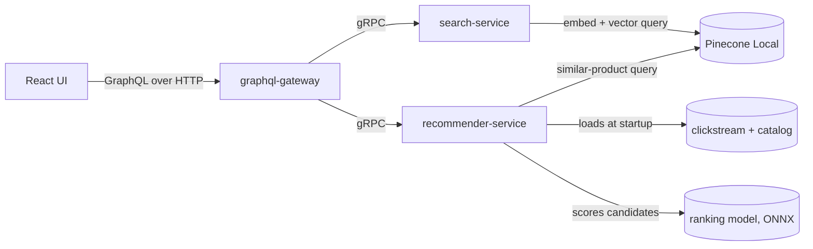

# Recommendation Engine

[](https://github.com/techbyavanti/recommendation-engine/actions/workflows/build.yml)

A full-stack product search and recommendation system for a real furniture catalog.
You search the catalog, select one of six recommendation strategies, and see how each strategy changes the results.

**[Open the live demo](https://techbyavanti.github.io/recommendation-engine/)**. The demo shows captured results for all six strategies side by side.
It is a static page. To run the full system, see [HOWTO.md](HOWTO.md).

## Summary

| | |
|---|---|
| **What it is** | A search and recommendation system: React UI, GraphQL gateway, three Java microservices, a vector database, and a trained ranking model. |
| **Data** | The [WANDS](https://github.com/wayfair/WANDS) catalog from Wayfair: 42,994 real products, 480 queries, and 233,448 human relevance labels. |
| **Scope** | 6 recommendation strategies, an offline evaluation harness, and a training pipeline for the ranking model. |
| **Engineering** | Hexagonal architecture, gRPC between services, more than 100 Java tests, and a CI pipeline with 6 quality and security jobs. |
| **Run it** | One `docker compose` stack on a laptop. |

## Where to start

| You are a... | Read this | Time |
|---|---|---|
| Recruiter | [Summary](#summary), [What this project shows](#what-this-project-shows), and the [live demo](https://techbyavanti.github.io/recommendation-engine/) | 2 minutes |
| Hiring manager | [What this project shows](#what-this-project-shows), [Results](#results), then [docs/STRATEGIES.md](docs/STRATEGIES.md) | 10 minutes |
| Engineering manager | [docs/ENGINEERING_PRACTICES.md](docs/ENGINEERING_PRACTICES.md) and [docs/DESIGN_DECISIONS.md](docs/DESIGN_DECISIONS.md) | 15 minutes |
| Code reviewer | [docs/ARCHITECTURE.md](docs/ARCHITECTURE.md), which gives a reading order through the code | 30 minutes |

## What this project shows

- **System design.** Each service uses a hexagonal (ports and adapters) structure. The business logic has no framework imports, so you can test it without Spring, a network, or Docker. The services communicate only through gRPC. A single GraphQL gateway is the only entry point for the frontend. See [docs/ARCHITECTURE.md](docs/ARCHITECTURE.md).
- **Applied machine learning.** A pairwise learning-to-rank model (XGBoost) learns from clickstream data and runs in Java through ONNX Runtime. A test makes sure that the Java features and the Python training features stay identical. See [training/TRAINING.md](training/TRAINING.md).
- **Honest measurement.** An offline harness scores each strategy against two independent ground truths. It also calculates an off-policy (IPS) reward estimate. The results include the negative findings. See [docs/EVALUATION.md](docs/EVALUATION.md).
- **Production practices.** CI runs tests, dependency and container vulnerability scans, static analysis, secret scanning, and Dockerfile lint on each change. Dependabot proposes dependency updates. See [docs/ENGINEERING_PRACTICES.md](docs/ENGINEERING_PRACTICES.md).
- **Research-based design.** Each strategy comes from a published paper or an engineering article from a company such as Netflix, Spotify, Etsy, or Pinterest. See [docs/REFERENCES.md](docs/REFERENCES.md).

## How it works



1. The user enters a query and selects a strategy in the React UI.
2. `graphql-gateway` sends the query to `search-service`.
3. `search-service` finds candidates with hybrid search. It combines vector search (Pinecone) and keyword search (BM25) with Reciprocal Rank Fusion.
4. The gateway sends the candidates to `recommender-service`. The selected strategy re-ranks them and can add products.
5. The gateway returns the final list to the UI.

## The six strategies

| Strategy | What it does |
|---|---|
| **None** | Returns the search results without change. This is the baseline. |
| **Popularity** | Combines search relevance with product popularity from the clickstream. |
| **Collaborative filtering** | Promotes products that other users used together with products that this user used. |
| **Bandit exploration** | Uses Thompson sampling across product categories to show more varied results. |
| **Neural ranking** | Scores each candidate with the trained XGBoost ranking model. |
| **Diverse popularity** | Applies Popularity, then spreads the results across categories (MMR re-ranking). |

For the algorithm, the design choices, and the sources for each strategy, see [docs/STRATEGIES.md](docs/STRATEGIES.md).

## Results

The evaluation replays 2,568 held-out user sessions through each strategy.

- **On the clickstream metric, no strategy is better than the baseline.** The baseline gets nDCG@5 0.505. The data set causes this result: its original result order already follows the human relevance grades.
- **On the human relevance labels, Popularity is a little better than the baseline** (nDCG@5 0.972 against 0.967). Collaborative filtering is also a little better.
- **The ranking model has a known weakness.** It has no feature that measures how well a product matches the query. Thus it has the lowest clickstream score.

These results are reported as measured. [docs/EVALUATION.md](docs/EVALUATION.md) explains the method and how to read the numbers. [RESULTS.md](RESULTS.md) has the full tables.

## Technology

| Area | Technology |
|---|---|
| Frontend | React 19, TypeScript 7, Vite, Apollo Client |
| API | GraphQL (Spring GraphQL) |
| Services | Java 26, Spring Boot 4, gRPC, Protocol Buffers |
| Search | Pinecone Local (vector search), in-memory BM25, `bge-small-en-v1.5` embeddings with ONNX Runtime |
| Machine learning | Python, XGBoost, ONNX |
| Build and run | Maven, npm, Docker Compose |
| CI and security | GitHub Actions, Trivy, Semgrep, Gitleaks, Hadolint, Dependabot |

## Run it

You need JDK 26, Maven, Docker, Node.js, and Python 3.

```bash
./scripts/download-data.sh      # 1. Get the catalog and clickstream data.
./scripts/download-models.sh    # 2. Get the embedding model.
(cd training && pip install -r requirements.txt && python train_neural_ranker.py)   # 3. Train the ranking model.
./scripts/start-services.sh     # 4. Start all services.
./scripts/ingest-catalog.sh     # 5. Load the catalog into Pinecone Local.
```

Then open http://localhost:5173. [HOWTO.md](HOWTO.md) gives each step in detail, with a check for each step.

## Repository map

| Folder | Contents |
|---|---|
| [`search-service/`](search-service) | gRPC service: hybrid vector and keyword search |
| [`recommender-service/`](recommender-service) | gRPC service: the six strategies and the offline evaluation harness |
| [`graphql-gateway/`](graphql-gateway) | The GraphQL API for the frontend, and a gRPC client of the two services |
| [`rec-support/`](rec-support) | Shared infrastructure: catalog file reader, embedding model, Pinecone client |
| [`web/`](web) | React frontend |
| [`proto/`](proto) | gRPC contracts between the services |
| [`training/`](training) | Python training pipeline for the ranking model |
| [`scripts/`](scripts) | Scripts to download data, start services, and run the evaluation |
| [`docs/`](docs) | Project documentation and the static demo page |

## Documentation

| Document | Contents |
|---|---|
| [docs/ARCHITECTURE.md](docs/ARCHITECTURE.md) | A tour of the code for reviewers: reading order, layers, and tests |
| [docs/DESIGN_DECISIONS.md](docs/DESIGN_DECISIONS.md) | The main technical decisions, the alternatives, and the trade-offs |
| [docs/STRATEGIES.md](docs/STRATEGIES.md) | How each recommendation strategy works |
| [docs/EVALUATION.md](docs/EVALUATION.md) | The evaluation method and a summary of the results |
| [RESULTS.md](RESULTS.md) | The full evaluation tables, generated by the harness |
| [training/TRAINING.md](training/TRAINING.md) | How the ranking model is trained and evaluated |
| [docs/ENGINEERING_PRACTICES.md](docs/ENGINEERING_PRACTICES.md) | Tests, CI, security scans, and dependency management |
| [docs/DATA.md](docs/DATA.md) | The data sets, their sizes, and their limits |
| [docs/REFERENCES.md](docs/REFERENCES.md) | The papers and articles behind each strategy |
| [docs/PROJECT_STATE.md](docs/PROJECT_STATE.md) | Operational facts and known limitations |
| [HOWTO.md](HOWTO.md) | Step-by-step instructions to run the system |

## Limitations

- The clickstream data is synthetic. It is not real user behavior. See [docs/DATA.md](docs/DATA.md).
- Pinecone Local stores data only in memory and holds a maximum of 100,000 vectors. It is for development and demonstration only.
- The system has more service boundaries than a catalog of this size needs. This is intentional, to show service design. [docs/DESIGN_DECISIONS.md](docs/DESIGN_DECISIONS.md) explains this trade-off.

For the full list, see [docs/PROJECT_STATE.md](docs/PROJECT_STATE.md).
